# Bebidas CRM

CRM web para una distribuidora de bebidas: gestión de pedidos, clientes, proveedores, catálogo de productos y equipo comercial, con un panel para administradores y otro para comerciales.

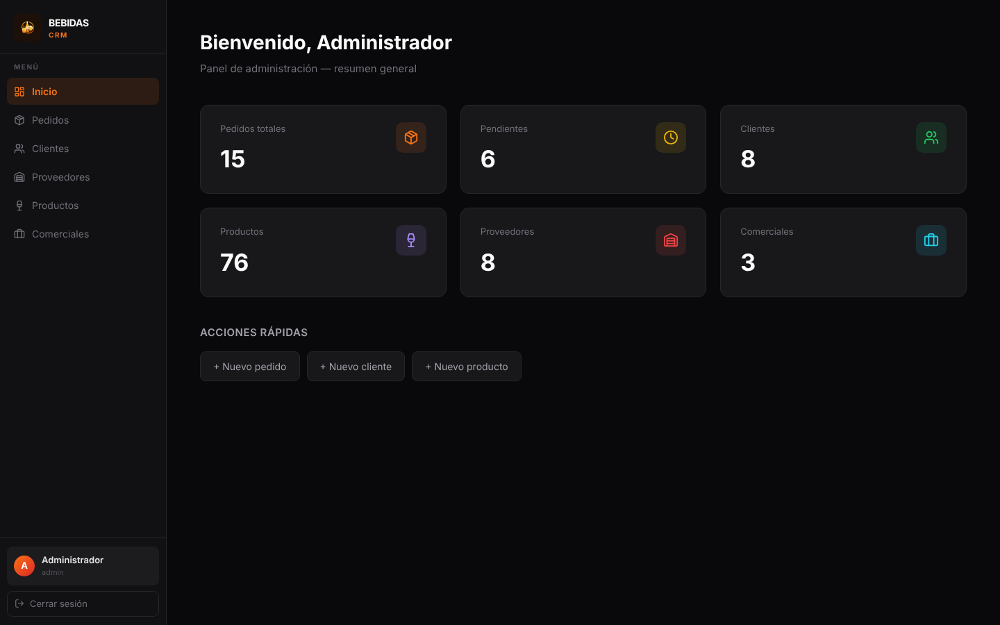

## Funcionalidades

- **Autenticación con roles**: login y registro con contraseñas cifradas (bcrypt) y sesión JWT en cookie. Cada rol (`admin` / `comercial`) tiene su propio panel y menú.
- **Pedidos**: alta con varias líneas de producto, cálculo automático del total, cambio de estado (pendiente, confirmado, entregado, cancelado), búsqueda, filtros y **factura en PDF**.
- **Clientes**: gestión por zona, con comercial asignado e histórico de compras.
- **Productos**: catálogo con filtros por categoría, stock, precios de compra/venta y ficha con estadísticas (unidades vendidas, ingresos, beneficio, top comerciales y ventas por mes).
- **Proveedores**: datos fiscales y de contacto, vinculados a sus productos.
- **Comerciales**: ficha de cada comercial con ventas totales, deuda pendiente, ventas por zona y pedidos recientes.
- **Panel del comercial**: cada comercial ve solo sus pedidos, clientes y ventas.

## Stack

| Capa | Tecnología |
|---|---|
| Frontend | Next.js 16 (App Router), React 19, TypeScript, Tailwind CSS 4, Lucide icons |
| Backend | API Routes de Next.js |
| Base de datos | Cloudflare D1 (SQLite) + Prisma ORM |
| Hosting | Cloudflare Workers (OpenNext) |
| Auth | JWT (jsonwebtoken) + bcryptjs |

## Capturas

| | |
|---|---|
| **Login**<br>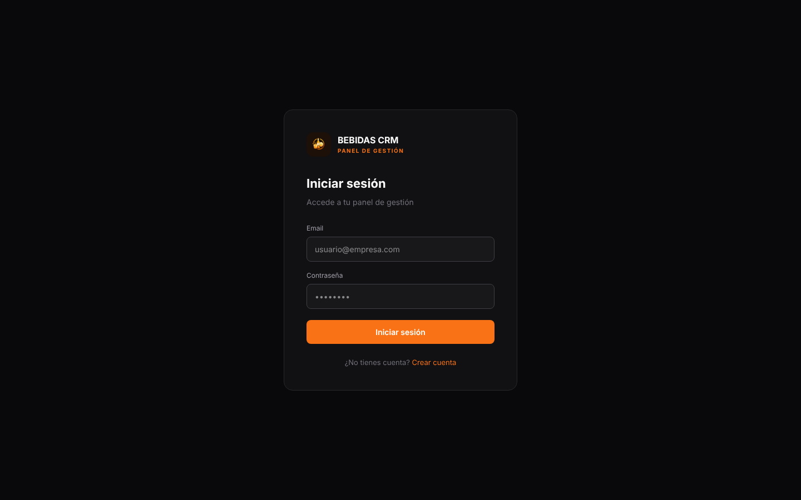 | **Pedidos**<br>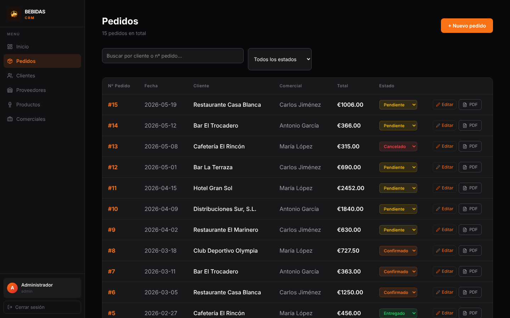 |
| **Nuevo pedido**<br>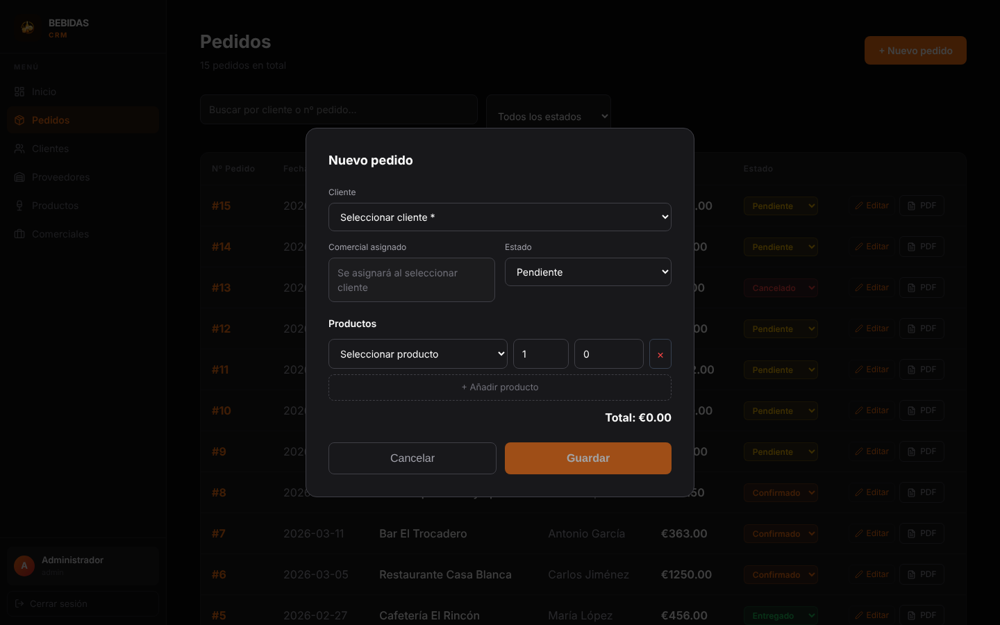 | **Productos**<br>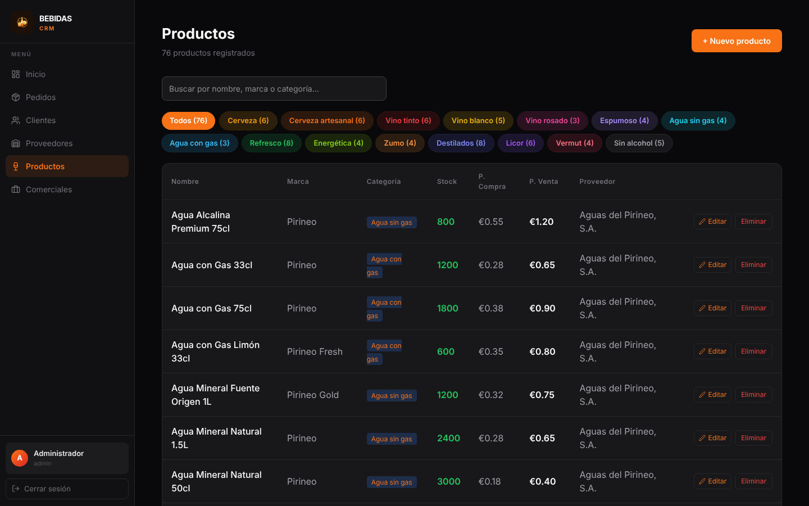 |
| **Ficha de producto**<br>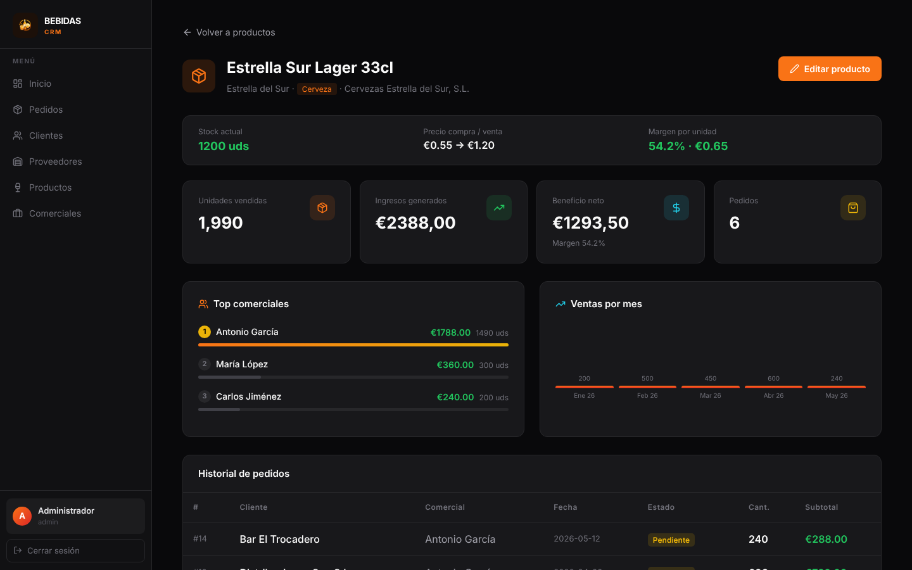 | **Ficha de comercial**<br>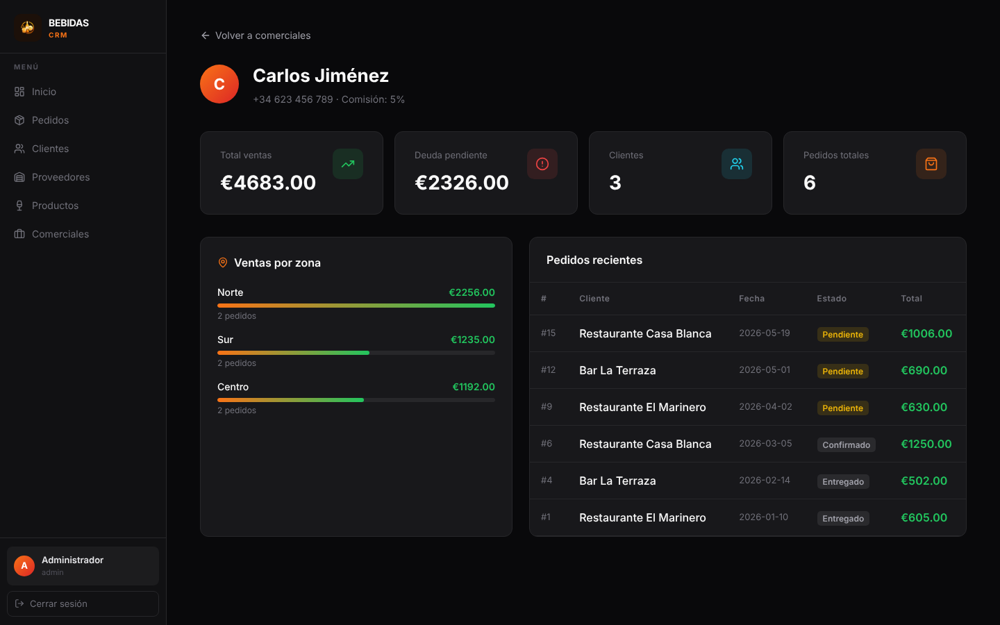 |
| **Clientes**<br>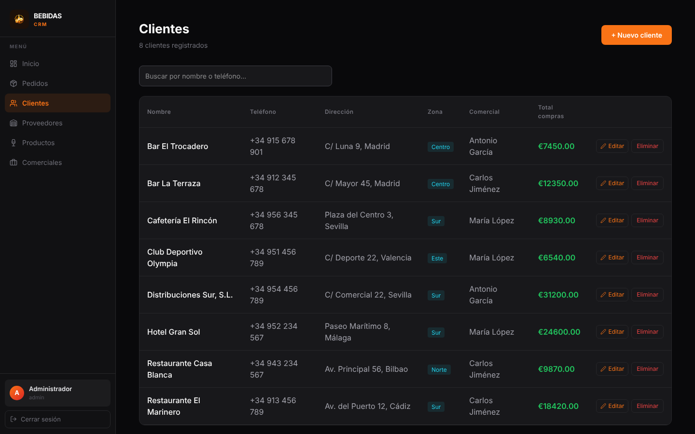 | **Proveedores**<br>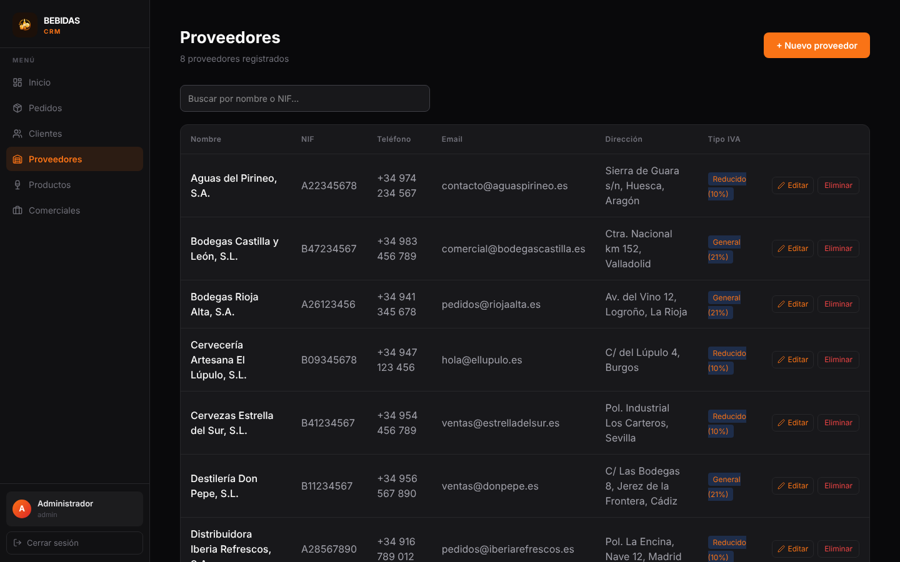 |
| **Comerciales**<br>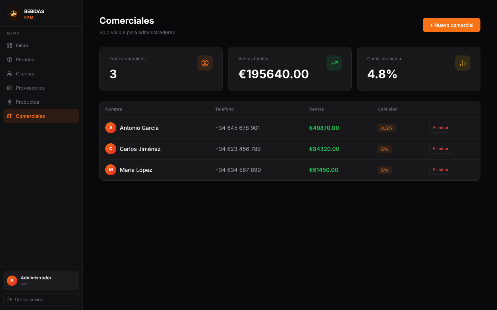 | **Panel del comercial**<br>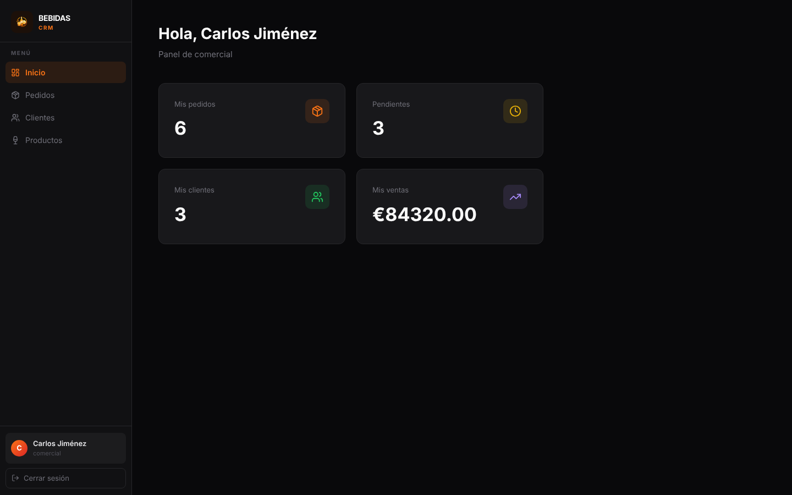 |

## Estructura

```
app/
  (auth)/login, register     → pantallas de acceso
  admin/dashboard/...        → panel de administración
  user/dashboard/...         → panel del comercial
  api/...                    → endpoints REST (auth, pedidos, clientes, productos, proveedores, comerciales, stats)
components/                  → tablas, sidebar y componentes de UI (modal, formularios)
hooks/                       → hooks de datos por entidad (usePedidos, useClientes…)
lib/                         → Prisma, auth JWT, usuario actual y generación de facturas
migrations/                  → migraciones SQL de D1
prisma/                      → esquema de Prisma y datos de ejemplo (seed.ts / seed.sql)
```

## Puesta en marcha (local)

Requisitos: Node.js 20+. No hace falta instalar ninguna base de datos: en local se usa una D1 simulada por Wrangler.

```bash
npm install
cp .dev.vars.example .dev.vars       # variables locales (JWT_SECRET)
npm run db:migrate:local             # crea las tablas
npm run db:seed:local                # carga los datos de ejemplo
npm run dev
```

Abre [http://localhost:3000](http://localhost:3000).

Para probarlo en el runtime real de Cloudflare (workerd): `npm run preview` → http://localhost:8787.

## Despliegue en Cloudflare

La base de datos D1 `bebidas-crm` ya está creada y configurada en `wrangler.jsonc`.

```bash
npx wrangler login
npx wrangler secret put JWT_SECRET   # una cadena larga y aleatoria
npm run db:migrate:remote            # solo la primera vez o con migraciones nuevas
npm run db:seed:remote               # opcional: datos de ejemplo
npm run deploy
```

También se puede conectar el repo en **Workers & Pages → Create → Import a repository** con el comando de build `npx opennextjs-cloudflare build` y el de deploy `npx wrangler deploy`, para que se despliegue en cada push.

### Usuarios de prueba (seed)

| Rol | Email | Contraseña |
|---|---|---|
| Admin | admin@bebidasnorte.es | Admin2024! |
| Comercial | carlos.jimenez@bebidasnorte.es | Pass2024! |
